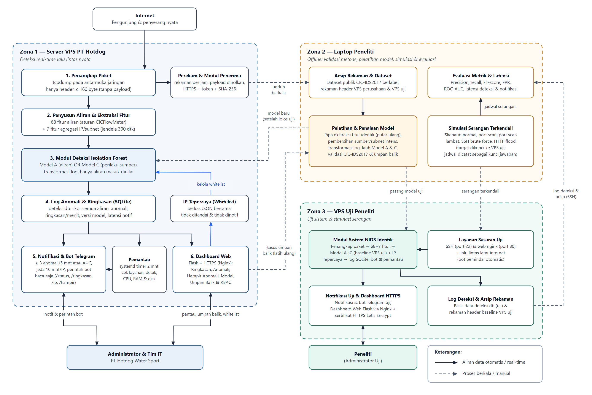
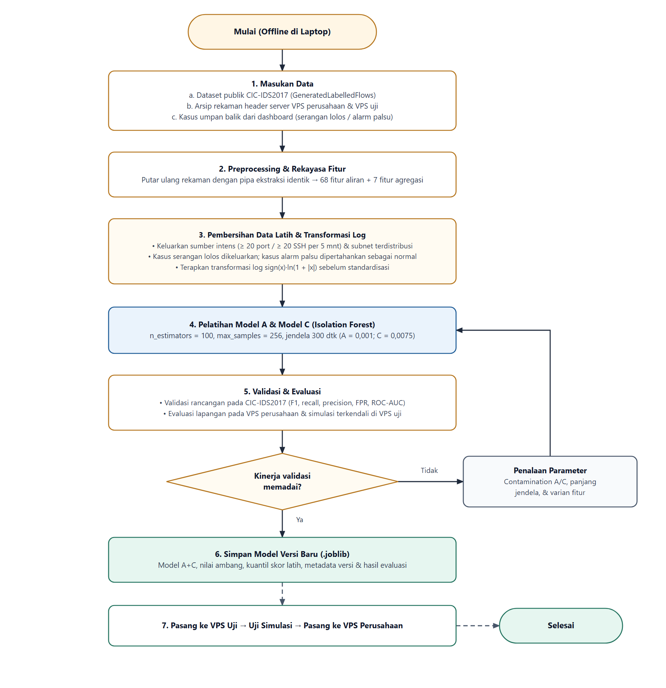

<div align="center">

# NIDS Anomaly Detection — Dual-Model Isolation Forest

**Rancang Bangun Network Intrusion Detection System (NIDS) Berbasis Machine Learning (*Unsupervised Anomaly Detection*) untuk Deteksi Anomali, Monitoring, dan Notifikasi Real-Time pada Server VPS**

[](https://www.python.org)
[](https://scikit-learn.org)
[](3_dashboard/)
[](https://www.sqlite.org)
[](2_sistem_nids/)
[](2_sistem_nids/deploy/)

*Sistem deteksi intrusi jaringan mandiri dan ringan tanpa ketergantungan aturan signature maupun API pihak ketiga berbayar — dibangun dari level ekstraksi paket hingga dashboard monitoring dan umpan balik.*

</div>

---

## Ringkasan Proyek

Server VPS ber-IP publik terus-menerus menjadi target pemindaian otomatis (*port scan*), *brute force* SSH, hingga banjir permintaan (*flood*). IDS berbasis *signature* hanya mengenali pola yang sudah terdaftar di basis aturan, sementara layanan deteksi anomali awan komersial berbayar dan terikat pada penyedia tertentu.

Proyek Tugas Akhir ini merancang dan membangun **sistem NIDS utuh (*end-to-end*) berbasis Isolation Forest** yang mempelajari pola lalu lintas normal server target itu sendiri secara *unsupervised*, lalu menjalankan deteksi *real-time*, pencatatan log terstruktur, peringatan Telegram, dashboard web, serta mekanisme umpan balik administrator.

### Arsitektur Dual-Model Isolation Forest (`A + C`)

Eksperimen awal menggunakan fitur per aliran (*per-flow*) tunggal menunjukkan kegagalan pada serangan bersifat **anomali kolektif** (*port scan* 0,23% dan *brute force* SSH 0,08% pada CIC-IDS2017) karena tiap koneksi tunggal tampak normal. Menggabungkan seluruh fitur ke dalam satu model juga membuat fitur agregasi tenggelam.

Solusi yang dirancang adalah **dua model Isolation Forest yang digabung dengan gerbang OR (`A OR C`)**:
- **Model A (68 fitur aliran gaya CICFlowMeter):** menangkap anomali pada karakteristik paket dan durasi dalam satu koneksi dua arah (seperti *DoS/flood* dan pola aliran tidak wajar).
- **Model C (7 fitur agregasi jendela 300 detik):** menangkap anomali kolektif berdasarkan perilaku IP sumber dan subnet `/24` (jumlah aliran, port unik, rasio koneksi gagal, aliran ke SSH, serta aktivitas subnet `/24`).
- **Penyempurnaan Data Nyata:** transformasi logaritmik (`sign · log1p`), pembersihan data latih dari sumber pemindai intens/subnet terdistribusi, serta penilaian khusus aliran masuk (*inbound*).

---

## Arsitektur Sistem



Sistem terbagi ke dalam dua alur terpisah:
1. **Alur Server (*Real-Time*):** penangkapan header paket (`tcpdump`, 160 byte) → penyusunan aliran & ekstraksi fitur (68 + 7 fitur) → inferensi Dual Isolation Forest (`A + C`) + cek daftar IP tepercaya → penyimpanan SQLite (`deteksi.db`) → notifikasi Telegram (syarat ≥ 3 anomali/5 menit atau kesepakatan `A+C`, jeda 10 menit/IP), bot Telegram baca-saja, pemantau kesehatan layanan, serta dashboard web Flask.
2. **Alur Offline (Pelatihan & Evaluasi):** perekaman header berprivasi (payload dinolkan) → *preprocessing* & pelatihan model di Jupyter Notebook → ekspor `model.joblib` ke server → pengujian terkendali pada VPS uji tersendiri.

<details>
<summary>Lihat Diagram Alur Real-Time Server & Alur Pelatihan Offline</summary>

### Alur Real-Time pada Server VPS


### Alur Pelatihan & Evaluasi Offline


Sumber diagram yang dapat disunting tersedia di [`docs/diagrams/Arsitektur_Sistem_NIDS_Terbaru.drawio`](docs/diagrams/Arsitektur_Sistem_NIDS_Terbaru.drawio).

</details>

---

## Ringkasan Hasil Uji Rancangan

### 1. Evaluasi Rancangan pada Dataset Benchmark CIC-IDS2017

| Metrik / Kategori | Model Per-Aliran (Awal) | Dual-Model `A + C` + Transformasi Log (Final) |
|---|---:|---:|
| **F1-Score** | 0,610 | **0,872** |
| **Recall (Detection Rate)** | — | **94,6%** |
| **Precision** | — | **81,0%** |
| **False Positive Rate (FPR)** | 9,26% | **7,1%** |
| **ROC-AUC** | — | **0,951** |
| Deteksi **Port Scan** | 0,23% | **99,97%** |
| Deteksi **SSH Brute Force** | 0,08% | **100,0%** |
| Deteksi **DoS** | 78,0% | **92,5%** |

### 2. Penalaan pada Data Produksi Nyata (20 Hari, 79.616 Aliran)
- Varian terpilih (**transformasi log + pembersihan sumber/subnet pemindai pada data latih**) meningkatkan deteksi IP penyerang dari **264 → 933 IP** dan cakupan aliran serangan intens dari **84% → 92%**, dengan *false positive* pada pengunjung web tetap di bawah **1% (0,95%)**.
- Latensi inferensi sangat ringan (**~3,85 µs/aliran**), memungkinkan sistem berjalan 24 jam di VPS berkapasitas kecil (1 vCPU, 4 GB RAM).

---

## Fitur Utama

- **Mesin Deteksi Real-Time (`nids-deteksi`):** pembacaan `tcpdump` tanpa *root* (`CAP_NET_RAW`), *micro-batching* (≤ 1 detik), filter lalu lintas keluar server, dan dukungan *whitelist* IP/subnet (`ip_tepercaya.json`) yang dimuat ulang otomatis.
- **Dashboard Web (Flask + Gunicorn):** gaya SOC/Wazuh dengan mode terang/gelap, grafik SVG sisi server, ringkasan 24 jam / 7 hari, penelusuran anomali, daftar **hampir anomali**, pencarian detail per IP, manajemen versi model, daftar IP tepercaya, manajemen pengguna berbasis peran (**Admin / Analis / Pemantau**), dan jejak audit lengkap.
- **Loop Umpan Balik Tanpa Latih Ulang:** analis/admin dapat melaporkan serangan lolos maupun alarm palsu; sistem menghitung ulang skor historis terhadap kuantil data latih dalam batas *contamination* aman untuk mengusulkan ambang baru atau menandai antrean pelatihan ulang.
- **Notifikasi & Bot Telegram (`nids-bot`):** peringatan anomali dengan dugaan kategori kejadian + *throttling* anti-spam, serta perintah baca-saja (`/status`, `/ringkasan`, `/ip`, `/hampir`) khusus chat admin terdaftar.
- **Pemantau Kesehatan (`nids-pantau`):** *systemd timer* tiap 2 menit untuk mendeteksi layanan mati, proses macet (*heartbeat* > 3 menit), lalu lintas sepi tak wajar, atau penggunaan RAM/disk kritis.

---

## Struktur Repositori

```text
Project-TA/
├── 1_perekam_traffic/        # Perekam header paket per jam (payload dinolkan, gzip, unggah HTTPS + SHA-256)
├── 2_sistem_nids/            # Mesin deteksi NIDS (Model A+C), bot Telegram, pemantau, skrip deploy, 25 uji
│   ├── nids/                 # pcap, aliran (68 fitur), agregasi (7 fitur), pipa, model, detektor, log, umpan balik
│   ├── deteksi.py            # Program utama (mode langsung & putar-ulang)
│   ├── latih_model.py        # Pelatihan model A+C (+ pembersihan data & umpan balik)
│   ├── ubah_ambang.py        # Pembaruan ambang model tanpa pelatihan ulang
│   ├── bot.py & pantau.py    # Bot Telegram interaktif & pemantau kesehatan sistem
│   └── tests/                # Unit test modul deteksi
├── 3_dashboard/              # Aplikasi web Flask (dashboard monitoring, RBAC, umpan balik, penerima rekaman, 48 uji)
├── 4_notebook/               # Notebook Jupyter 00–07 (unduh dataset, preprocessing, training, evaluasi, penalaan)
├── 5_simulasi_serangan/      # Simulator serangan terkendali (khusus VPS uji) & evaluator metrik + 4 uji
└── docs/
    └── diagrams/             # Diagram arsitektur (.drawio & PNG resolusi tinggi)
```

> **Catatan Privasi & Keamanan Repositori:** Repositori publik ini hanya memuat kode sumber, skrip pengujian, notebook tanpa *output* mentah, dan diagram arsitektur. Data eksperimen mentah (dataset CIC-IDS2017 dan rekaman lalu lintas server), berkas model terlatih (`.joblib`), basis data (`.db`), kredensial/token, alamat IP server asli, serta aset visual milik perusahaan studi kasus sengaja tidak disertakan.

---

## Pengujian Otomatis

Seluruh rangkaian pengujian berjalan secara lokal tanpa koneksi ke server mana pun:

```bash
# 1. Modul deteksi NIDS (25 uji)
python -m pytest -q 2_sistem_nids/tests

# 2. Dashboard web, API penerima, RBAC & keamanan sesi (48 uji)
python -m pytest -q 3_dashboard/tests

# 3. Simulator serangan lokal & perhitungan metrik evaluasi (4 uji)
python -m pytest -q 5_simulasi_serangan/tests
```

---

## Keamanan & Privasi Desain

- **Privasi Lalu Lintas:** Perekaman hanya menyalin 160 byte header paket dan menolkan *payload* sebelum meninggalkan server; isi komunikasi pengguna tidak pernah disimpan.
- **Prinsip Hak Istimewa Minimum:** Layanan deteksi dan perekam berjalan sebagai pengguna non-root dengan kapabilitas terbatas (`CAP_NET_RAW`).
- **Keamanan Aplikasi Web:** *Content Security Policy* ketat (`default-src 'self'`, tanpa *inline style/script*), proteksi CSRF, batas percobaan login per IP, *session timeout*, dan pencatatan jejak audit pada seluruh aksi administratif.

---

<div align="center">

Dikembangkan sebagai proyek Tugas Akhir oleh **Putu Satria Arya Putra**  
Program Studi Teknologi Informasi, Fakultas Teknik, Universitas Udayana

</div>
