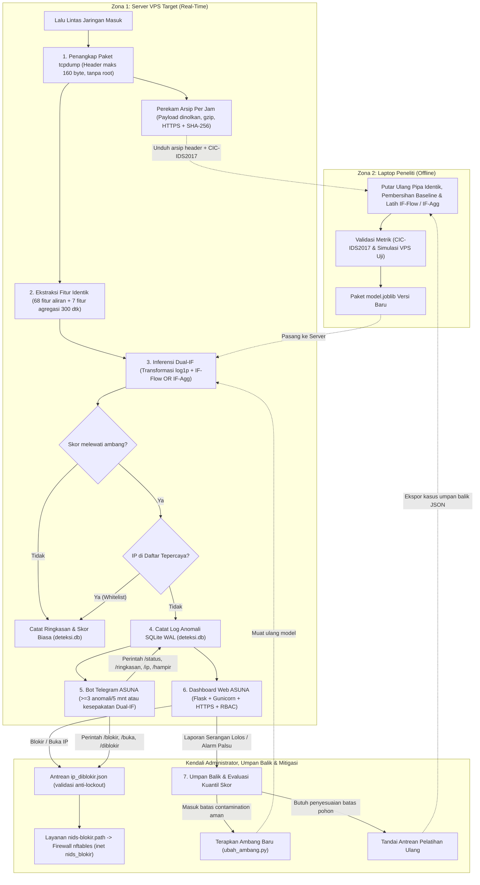
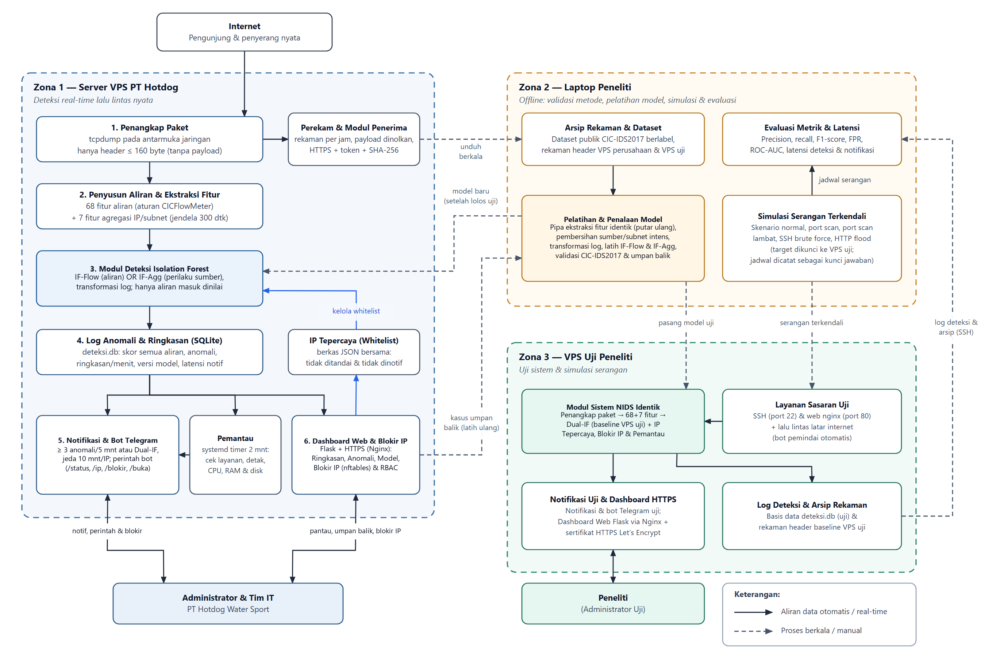
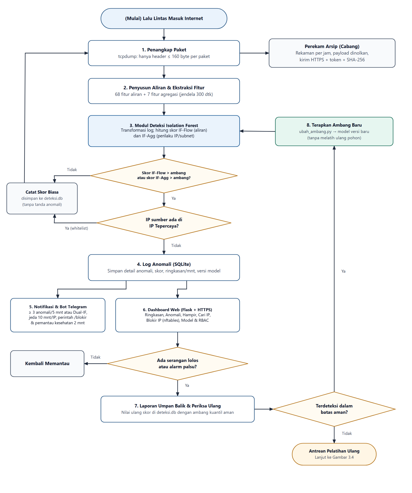
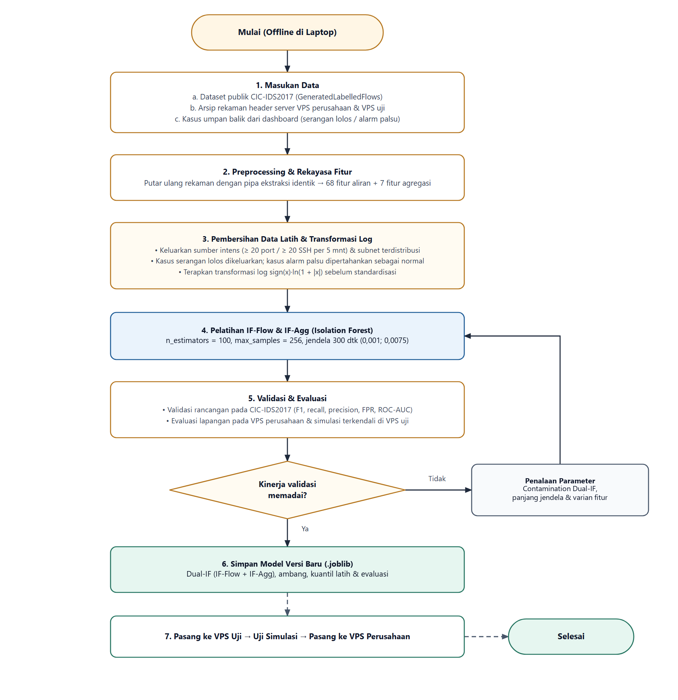

<div align="center">

# ASUNA — Network Intrusion Detection System (`Dual-IF`)

**Rancang Bangun Network Intrusion Detection System (NIDS) Berbasis Machine Learning (*Unsupervised Anomaly Detection*) untuk Deteksi Anomali, Monitoring, Notifikasi Real-Time, dan Pemblokiran IP pada Server VPS**

[](https://www.python.org)
[](https://scikit-learn.org)
[](3_dashboard/)
[](https://www.sqlite.org)
[](2_sistem_nids/)
[](2_sistem_nids/deploy/)

*Sistem deteksi intrusi jaringan mandiri tanpa ketergantungan aturan signature maupun API pihak ketiga berbayar — mencakup perekaman header privasi-aman, deteksi Dual Isolation Forest (`IF-Flow` dan `IF-Agg`), antarmuka dashboard web & bot Telegram (**ASUNA**), loop umpan balik, hingga pemblokiran IP via `nftables`.*

</div>

---

## Ringkasan Proyek

Server VPS ber-IP publik terus-menerus menjadi sasaran pemindaian port (*port scan*), *brute force* SSH, hingga banjir permintaan (*flood*). IDS berbasis *signature* hanya mengenali pola yang sudah terdaftar pada basis aturan, sedangkan layanan keamanan awan komersial bergantung pada biaya langganan pihak ketiga.

Proyek Tugas Akhir ini membangun **sistem NIDS *end-to-end* berbasis Isolation Forest** yang mempelajari perilaku lalu lintas normal server target secara *unsupervised*, menjalankan deteksi *real-time*, mencatat log terstruktur, menampilkan dashboard web & bot Telegram **ASUNA**, menyediakan mekanisme umpan balik administrator, serta mendukung pemblokiran alamat IP penyerang secara manual lewat firewall kernel (`nftables`).

### Arsitektur `Dual-IF` (`IF-Flow` + `IF-Agg`)

Eksperimen awal menggunakan fitur per aliran (*per-flow*) tunggal gagal menangkap serangan bertipe **anomali kolektif** (*port scan* 0,23% dan *brute force* SSH 0,08% pada CIC-IDS2017) karena tiap koneksi individual terlihat normal. Di sisi lain, menyatukan semua fitur ke dalam satu model (`IF-Joint`) membuat fitur agregasi jarang terpilih oleh pohon acak.

Solusi yang diterapkan adalah **arsitektur paralel `Dual-IF` dengan gerbang logika `OR`**:
- **`IF-Flow` (68 fitur aliran gaya CICFlowMeter):** mendeteksi anomali karakteristik paket dan laju pada satu sesi komunikasi dua arah (misalnya *DoS / HTTP flood*).
- **`IF-Agg` (7 fitur agregasi jendela 300 detik):** mendeteksi anomali kolektif berdasarkan perilaku IP sumber dan subnet `/24` maupun `/64` (jumlah aliran, port unik, rasio koneksi gagal, aliran ke SSH, serta aktivitas terdistribusi per subnet).
- **Transformasi & Pembersihan Baseline:** seluruh fitur dinormalisasi dengan transformasi *signed* log (`sgn(x) * ln(1 + |x|)`) sebelum standardisasi, serta data latih lokal dibersihkan dari IP/subnet pemindai intens agar batas normal tidak melebar.

---

## Diagram Alur Sistem

Diagram alur ringkas di bawah merangkum alur kerja sistem secara keseluruhan, mulai dari penangkapan lalu lintas, deteksi **Dual-IF**, antarmuka **ASUNA**, pemblokiran IP, hingga pelatihan ulang *offline*:



### 1. Arsitektur Umum Sistem (3 Zona)



### 2. Diagram Alur Sistem Real-Time pada Server VPS



### 3. Diagram Alur Pelatihan & Pemutakhiran Model Offline



> Sumber diagram yang dapat disunting tersedia pada [`docs/diagrams/Arsitektur_Sistem_NIDS_Revisi.drawio`](docs/diagrams/Arsitektur_Sistem_NIDS_Revisi.drawio).

---

## Ringkasan Hasil Uji Rancangan

### 1. Evaluasi Rancangan pada Dataset Benchmark CIC-IDS2017

| Metrik / Kategori | `IF-Flow` Awal | `Dual-IF` (`IF-Flow + IF-Agg`) + Transformasi Log |
|---|---:|---:|
| **F1-Score** | 0,610 | **0,872** |
| **Recall (Detection Rate)** | — | **94,6%** |
| **Precision** | — | **81,0%** |
| **False Positive Rate (FPR)** | 9,26% | **7,1%** |
| **ROC-AUC** | — | **0,951** |
| Deteksi **Port Scan** | 0,23% | **99,97%** |
| Deteksi **SSH Brute Force** | 0,08% | **100,0%** |
| Deteksi **DoS** | 78,0% | **92,5%** |

### 2. Penalaan pada Data Lalu Lintas Server Nyata (20 Hari, 79.616 Aliran)
- Varian terpilih (**transformasi *signed* `log1p` + pembersihan sumber/subnet pemindai pada data latih**) meningkatkan deteksi IP penyerang dari **264 → 933 IP** dan cakupan aliran serangan intens dari **84% → 92%**, dengan *false positive* pengunjung web terjaga pada **0,95%** (< 1%).
- Waktu inferensi ringan (**~3,85 µs/aliran**), memungkinkan pemantauan kontinu pada VPS berkapasitas 1 vCPU dan 4 GB RAM.

---

## Fitur Utama

- **Mesin Deteksi Real-Time (`nids-deteksi`):** penangkapan header paket `tcpdump` tanpa hak *root* (`CAP_NET_RAW`), *micro-batching* (≤ 1 detik), filter lalu lintas keluar server, dan pengecualian daftar IP tepercaya (`ip_tepercaya.json`).
- **Dashboard Web ASUNA (`ta-nids-server`):** aplikasi Flask + Gunicorn + Nginx HTTPS dengan mode terang/gelap, grafik SVG sisi server, ringkasan 24 jam / 7 hari, daftar anomali & hampir anomali, pencarian riwayat per IP, manajemen model, IP tepercaya, manajemen pengguna berbasis peran (**Admin / Analis / Pemantau**), dan log audit.
- **Pemblokiran IP Manual Terproteksi (`nids-blokir`):** administrator dapat memblokir maupun membuka blokir IP atau rentang jaringan (maksimal `/24` IPv4 dan `/64` IPv6) lewat halaman **Blokir IP** di dashboard maupun perintah bot Telegram (`/blokir`, `/buka`, `/diblokir`). Penegakan aturan dijalankan oleh layanan `root` terpisah berbasis `systemd` *path unit* ke tabel firewall kernel `nftables` (`inet nids_blokir`), lengkap dengan validasi **anti-lockout** terhadap alamat loopback, privat, dan IP server sendiri.
- **Loop Umpan Balik Tanpa Latih Ulang:** laporan serangan lolos atau alarm palsu dari administrator dievaluasi kembali terhadap kuantil skor latih dalam batas *contamination* aman (`IF-Flow` ≤ 1%, `IF-Agg` ≤ 5%) sebelum mengusulkan ambang baru atau antrean pelatihan ulang.
- **Notifikasi & Bot Telegram ASUNA (`nids-bot` + `nids-pantau`):** peringatan anomali lengkap dengan kategori kejadian dan *throttling* anti-spam (jeda 10 menit/IP), perintah status & kontrol bot khusus `TELEGRAM_CHAT_ID` terverifikasi, serta pemantauan kesehatan layanan tiap 2 menit.

---

## Struktur Repositori

```text
Project-TA/
├── 1_perekam_traffic/        # Perekam header paket per jam (payload dinolkan, gzip, unggah HTTPS + SHA-256)
├── 2_sistem_nids/            # Mesin deteksi Dual-IF, bot Telegram ASUNA, pemantau, blokir nftables (29 uji)
│   ├── nids/                 # pcap, aliran (68 fitur), agregasi (7 fitur), pipa, model, detektor, log, blokir
│   ├── deteksi.py            # Program utama (mode langsung & putar-ulang identik)
│   ├── latih_model.py        # Pelatihan IF-Flow & IF-Agg (+ pembersihan data & umpan balik)
│   ├── ubah_ambang.py        # Penalaan ambang tanpa melatih ulang pohon
│   ├── blokir.py             # Layanan sinkronisasi antrean IP ke firewall nftables
│   ├── bot.py & pantau.py    # Bot Telegram ASUNA & pemantau kesehatan systemd
│   └── tests/                # Unit test modul deteksi, bot, pemantau, umpan balik, dan blokir IP
├── 3_dashboard/              # Dashboard web ASUNA (Flask, RBAC, umpan balik, blokir IP, penerima, 49 uji)
├── 4_notebook/               # Notebook Jupyter 00–07 (dataset, preprocessing, training, evaluasi, penalaan)
├── 5_simulasi_serangan/      # Simulator serangan terkendali & evaluator metrik + 4 uji
└── docs/
    └── diagrams/             # Diagram arsitektur & alur kerja (.drawio & PNG resolusi tinggi)
```

> **Catatan Privasi & Keamanan Repositori:** Repositori publik ini hanya memuat kode sumber, skrip pengujian, notebook tanpa *output* mentah, dan diagram arsitektur. Data eksperimen mentah (CIC-IDS2017 dan rekaman lalu lintas server), berkas model terlatih (`.joblib`), basis data (`.db`), kredensial/token, alamat IP server asli, serta aset visual milik perusahaan studi kasus tidak disertakan.

---

## Pengujian Otomatis

Seluruh **82 pengujian otomatis** berjalan secara lokal tanpa koneksi ke server mana pun:

```bash
# 1. Modul deteksi NIDS, bot, pemantau & blokir IP (29 uji)
python -m pytest -q 2_sistem_nids/tests

# 2. Dashboard web ASUNA, blokir IP UI, API penerima, RBAC & keamanan sesi (49 uji)
python -m pytest -q 3_dashboard/tests

# 3. Simulator serangan lokal & perhitungan metrik evaluasi (4 uji)
python -m pytest -q 5_simulasi_serangan/tests
```

---

## Keamanan & Privasi Desain

- **Privasi Lalu Lintas:** perekaman hanya menyalin 160 byte header paket dan menolkan *payload* sebelum meninggalkan server; isi komunikasi pengguna tidak pernah disimpan.
- **Pemisahan Hak Istimewa:** perekam dan mesin deteksi berjalan tanpa hak *root* (`CAP_NET_RAW`), *dashboard* berjalan baca-saja terhadap `deteksi.db`, sedangkan manipulasi `nftables` diisolasi pada layanan `nids-blokir` dengan berkas antrean tervalidasi.
- **Keamanan Aplikasi Web:** *Content Security Policy* ketat (`default-src 'self'`, tanpa *inline style/script*), proteksi CSRF, pembatasan percobaan login per IP, *session timeout*, dan pencatatan jejak audit pada seluruh aksi administratif.

---

<div align="center">

Dikembangkan sebagai proyek Tugas Akhir oleh **Putu Satria Arya Putra**  
Program Studi Teknologi Informasi, Fakultas Teknik, Universitas Udayana

</div>
